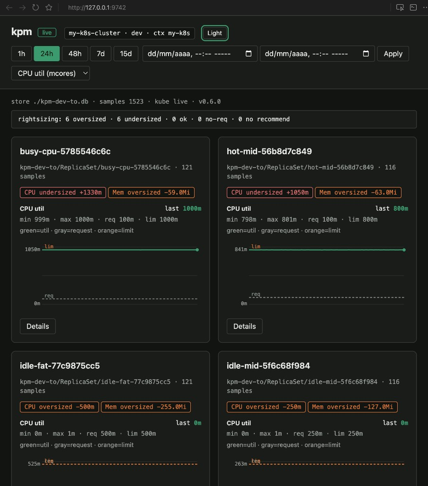
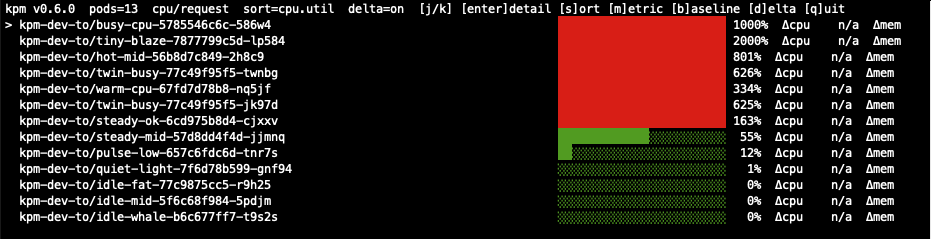
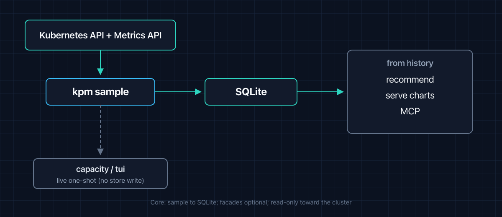

# kpm-selfhosted

[](https://github.com/hrodrig/kpm-selfhosted/releases)
[](https://github.com/hrodrig/kpm-selfhosted/releases)
[](https://opensource.org/licenses/MIT)
[](https://github.com/hrodrig/kpm/pkgs/container/kpm)
[](https://github.com/hrodrig/kpm)
[](https://github.com/hrodrig/kpm-selfhosted/actions/workflows/ci.yml)
[](https://gghstats.hermesrodriguez.com/hrodrig/kpm-selfhosted)


Deployment manifests and operator notes for **[kpm](https://github.com/hrodrig/kpm)** — `docker run`, in-cluster CronJob/Deployment (SQLite on PVC), standalone cron/systemd. **App source and releases:** [github.com/hrodrig/kpm](https://github.com/hrodrig/kpm).

> **Operator snapshot.** The Version badge is this repo. The image pin below is a published [kpm](https://github.com/hrodrig/kpm) release. Manifests are examples. Software is provided **“AS IS”** — see the [MIT License](./LICENSE).

**Default app image pin:** [`ghcr.io/hrodrig/kpm:v1.1.0`](https://github.com/hrodrig/kpm/releases/tag/v1.1.0).

**Walkthrough (DEV.to):** [kpm — Kubernetes rightsizing without Prometheus, history on your laptop](https://dev.to/hrodrig/kpm-kubernetes-rightsizing-without-prometheus-history-on-your-laptop-4272) · product screens in the [kpm README](https://github.com/hrodrig/kpm#whats-new-in-06--analyze-local-charts).

**Policies:** [Community and policies](#community-and-policies), [community standards](#community-standards) — changelog, contributing, security, code of conduct, agent guidelines.



*`kpm serve` (same binary as the pin above): analyze-local charts from the SQLite store you persist on a PVC or host volume.*



*Live TUI (`kpm tui`) — useful on a bastion after installing the release binary; daemon/CronJob shapes keep history for recommend / serve.*



---

## Table of contents

- [Pick a path](#pick-a-path)
- [What is in this repo (and what is not)](#what-is-in-this-repo-and-what-is-not)
- [Standalone binary](#standalone-binary)
- [Docker single container](#docker-single-container)
- [Kubernetes manifests](#kubernetes-manifests)
- [Example profiles](#example-profiles)
- [Secrets and notifications](#secrets-and-notifications)
- [Repository layout](#repository-layout)
- [Versioning](#versioning)
- [Checks](#checks)
- [Community and policies](#community-and-policies)
- [Community standards](#community-standards)
- [License](#license)

---

## Pick a path

| You want… | Section |
|-----------|---------|
| **Binary only** (no Docker) | [Standalone binary](#standalone-binary) — Linux: [cron / systemd](run/standalone/linux/README.md) |
| **Single container** (`docker run`) | [Docker single container](#docker-single-container) |
| **Kubernetes, scheduled sample** | [Kubernetes manifests](#kubernetes-manifests) — [cronjob.yaml](run/kubernetes/manifests/cronjob.yaml) or Helm `sampler=cronjob` |
| **Kubernetes, daemon** | Flat [deployment.yaml](run/kubernetes/manifests/deployment.yaml) or the [Helm chart](#helm). Liveness is `/livez`. |
| **Kubernetes, no egress** | [private-registry.md](run/kubernetes/private-registry.md) — mirror the chart and images, then install from your registry |
| **Starter YAML** | [Example profiles](#example-profiles) |

Deeper index: **[`run/README.md`](run/README.md)**.

**[↑ Contents](#table-of-contents)**

---

## What is in this repo (and what is not)

| In **kpm-selfhosted** | In **[hrodrig/kpm](https://github.com/hrodrig/kpm)** |
|-----------------------|-----------------------------------------------------|
| Operator README, **`run/`** | CLI source, **`make release-check`**, unit tests |
| Docker / Kubernetes / standalone notes | **`ghcr.io/hrodrig/kpm`**, binaries, `.deb` / `.rpm` |
| Example profiles under **`run/examples/`** | Canonical sample: **`configs/kpm.sample.yml`** |
| Docs CI (`make release-check`) | govulncheck, grype, GoReleaser, Cosign, SBOM |

**Not shipped here:** Docker Compose, kind e2e. Flat manifests: **`run/kubernetes/manifests/`**. Helm chart: **`run/kubernetes/helm/kpm/`**.

**[↑ Contents](#table-of-contents)**

---

## Standalone binary

**Goal:** run **kpm** without Docker — release tarball, packages, or `go install`.

**All implementation detail** (cron lines, systemd unit sketch, BSD ports) is in **[`run/standalone/`](run/standalone/README.md)** — start with **[Linux](run/standalone/linux/README.md)**.

**Smoke test** (one-shot sample → SQLite) — install from [kpm Install](https://github.com/hrodrig/kpm/blob/main/README.md#install), copy a profile, point at your kubeconfig:

```bash
# Example: go install or extract a release tarball onto PATH
export KUBECONFIG="$HOME/.kube/config"
cp run/examples/kpm-minimal.yml /tmp/kpm.yml
# Edit store.path and optional scope in /tmp/kpm.yml for your cluster
kpm sample --config /tmp/kpm.yml
kpm recommend --config /tmp/kpm.yml
```

**macOS / BSD:** [run/standalone/macos](run/standalone/macos/README.md) · [run/standalone/bsd](run/standalone/bsd/README.md)

**[↑ Contents](#table-of-contents)**

---

## Docker single container

**Goal:** one container, no Compose file. Image is **distroless** (no shell).

**Image:** `ghcr.io/hrodrig/kpm:v1.1.0`

### One-shot (single sample)

```bash
docker run --rm \
  -v "$HOME/.kube/config:/kube/config:ro" \
  -v "$(pwd)/run/examples/kpm-minimal.yml:/config/kpm.yml:ro" \
  -v "$HOME/.local/share/kpm:/data" \
  -e KUBECONFIG=/kube/config \
  -e KPM_SLACK_WEBHOOK \
  ghcr.io/hrodrig/kpm:v1.1.0 \
  sample --config /config/kpm.yml
```

Mount a host directory for **`store.path`** so SQLite history survives container exit. Omit `KPM_SLACK_WEBHOOK` when sinks are disabled.

**Check:** process exit `0` on success; exit `2` on cluster / Metrics / RBAC failure.

### Daemon (`interval_seconds > 0`)

```bash
docker run -d --name kpm \
  -v "$HOME/.kube/config:/kube/config:ro" \
  -v "$(pwd)/run/examples/kpm-daemon.yml:/config/kpm.yml:ro" \
  -v "$HOME/.local/share/kpm:/data" \
  -e KUBECONFIG=/kube/config \
  -e KPM_SLACK_WEBHOOK \
  -e KPM_SERVER_TOKEN \
  -p 127.0.0.1:9740:9740 \
  ghcr.io/hrodrig/kpm:v1.1.0 \
  sample --config /config/kpm.yml
```

**Check:** `curl -sS -o /dev/null -w '%{http_code}\n' http://127.0.0.1:9740/livez` (expect `200` when MCP/server listen is enabled).

**Remove:**

```bash
docker stop kpm && docker rm kpm
```

**More:** [run/docker/README.md](run/docker/README.md)

**[↑ Contents](#table-of-contents)**

---

## Kubernetes manifests

**Goal:** run **kpm** in-cluster with a **ServiceAccount**, **read-only** RBAC, and a **PVC** for the SQLite store. Flat manifests or the Helm chart.

**Image pin in manifests:** `ghcr.io/hrodrig/kpm:v1.1.0`

```bash
kubectl apply -f run/kubernetes/manifests/namespace.yaml
kubectl apply -f run/kubernetes/manifests/rbac.yaml
kubectl apply -f run/kubernetes/manifests/pvc.yaml
kubectl apply -f run/kubernetes/manifests/configmap.yaml
# Optional notify / MCP token: create Secret from secret.example.yaml (do not commit real values)
# kubectl apply -f run/kubernetes/manifests/secret.yaml
```

Then choose **one** sampler. Both mount the same ReadWriteOnce PVC.

| Shape | Manifest | ConfigMap key |
|-------|----------|---------------|
| Scheduled one-shot sample | [cronjob.yaml](run/kubernetes/manifests/cronjob.yaml) | `kpm.yml` (`sample.interval_seconds: 0`) |
| Long-running daemon + Service `:9740` | [deployment.yaml](run/kubernetes/manifests/deployment.yaml) | `kpm-daemon.yml` (`interval_seconds > 0`, `server.enabled`, MCP off) |

With the daemon, apply [recommend-cronjob.yaml](run/kubernetes/manifests/recommend-cronjob.yaml) too. That Job does not mount the disk. It `kubectl exec`s `kpm recommend --record` into the daemon pod once a day, including weekends, so the charts and `GET /api/v1/recommendations` stay filled while an admin bastion is off. Exit code 3 (not enough samples yet) fails the Job until `min_samples` is met.

Edit `scope:` / `cluster:` in the ConfigMap for your workloads. Full walkthrough: **[run/kubernetes/README.md](run/kubernetes/README.md)**.

### Helm

Chart: [run/kubernetes/helm/kpm](run/kubernetes/helm/kpm). Package `version` is the chart. `appVersion` is the kpm image (`v1.1.0` when `image.tag` is empty). Repo `VERSION` stays the docs snapshot. Secret contract and examples: [chart README](run/kubernetes/helm/kpm/README.md).

`secrets.existingSecret` is the name of a Secret you create. The chart does not create it and does not accept the token in values. With the daemon and `server.enabled`, install fails if the name is empty. The Deployment loads every key via `envFrom`. `KPM_SERVER_TOKEN` is the charts bearer.

```bash
kubectl -n kpm create secret generic kpm-secrets \
  --from-literal=KPM_SERVER_TOKEN="$(openssl rand -hex 32)"

helm repo add kpm https://hrodrig.github.io/kpm-selfhosted/
helm repo update
helm install kpm kpm/kpm \
  --namespace kpm --create-namespace \
  --set secrets.existingSecret=kpm-secrets
```

Default `sampler` is `daemon` (one replica, RWO PVC, charts on `:9740`, MCP off). `sampler=cronjob` is the one-shot sample Job and does not render the Deployment. The recommend CronJob execs into the daemon and does not mount the disk. Do not install the chart and the flat manifests against the same claim.

A repo tag `v*` runs [Release Charts](.github/workflows/release-charts.yml). chart-releaser publishes GitHub Release `kpm-<chartVersion>` and the `gh-pages` index (`https://hrodrig.github.io/kpm-selfhosted`). That is separate from the docs Release for the same git tag. Set GitHub Pages to branch `gh-pages`, folder `/`. Do not edit `gh-pages` by hand. The job packages a chart only when that tag's diff touches `run/kubernetes/helm/`.

**[↑ Contents](#table-of-contents)**

---

## Example profiles

| File | Shape |
|------|--------|
| [run/examples/kpm-minimal.yml](run/examples/kpm-minimal.yml) | One-shot sample (`interval_seconds: 0`) |
| [run/examples/kpm-daemon.yml](run/examples/kpm-daemon.yml) | Daemon + charts/`/api/v1` on `:9740` (MCP off) |

Schema: upstream [SPECIFICATIONS.md](https://github.com/hrodrig/kpm/blob/main/SPECIFICATIONS.md) and [configs/kpm.sample.yml](https://github.com/hrodrig/kpm/blob/main/configs/kpm.sample.yml).

**[↑ Contents](#table-of-contents)**

---

## Secrets and notifications

Notification sinks and bearer tokens are **fail-closed** via env vars (e.g. **`KPM_SLACK_WEBHOOK`**, **`KPM_SERVER_TOKEN`**, and **`KPM_MCP_TOKEN`** only when MCP is enabled) — never put secrets in committed YAML.

- Docker / standalone: export the env var (or `EnvironmentFile=` in systemd).
- Kubernetes manifests: copy [secret.example.yaml](run/kubernetes/manifests/secret.example.yaml), apply as Secret `kpm-secrets`, leave sinks out of the profile if unused.
- Helm: the chart does not create that Secret. Pass its name as `secrets.existingSecret`. See [chart README](run/kubernetes/helm/kpm/README.md).

**[↑ Contents](#table-of-contents)**

---

## Repository layout

```text
run/
├── docker/                      # docker run notes
├── examples/                    # kpm-minimal.yml, kpm-daemon.yml
├── kubernetes/
│   ├── manifests/             # namespace, RBAC, PVC, ConfigMap, sample CronJob, recommend CronJob, Deployment, Secret example
│   └── helm/kpm/              # Helm chart (daemon default, MCP off)
└── standalone/{linux,macos,bsd}/
testing/
└── scripts/                     # release-check.sh, extract-changelog.sh
assets/                          # README hero + product captures (TUI / serve / flow)
Makefile                         # release-check, helm-lint
```

Maintainers: **`make release-check`** before tagging — see **[CONTRIBUTING.md](CONTRIBUTING.md)**.

**[↑ Contents](#table-of-contents)**

---

## Versioning

| Field | Meaning |
|-------|---------|
| **[`VERSION`](VERSION)** / Git tag **`v*`** | Snapshot of **this** repository (docs + manifests). Align the README **Version** badge and **CHANGELOG.md**. |
| **`ghcr.io/hrodrig/kpm:vX.Y.Z`** in `run/` | Upstream **kpm** application image — pin a [published release](https://github.com/hrodrig/kpm/releases). |

Bump this repo’s **`VERSION`** when operator assets change. Pin a new app tag when documenting a new **kpm** release (image pin ≠ repo snapshot unless you cut both).

Pushing a tag on **`main`** runs [**.github/workflows/release.yml**](.github/workflows/release.yml) to create the GitHub Release from **`CHANGELOG.md`**. Work in progress lands on **`develop`** first — prefer **`main`** or a **tag** for reproducible paths.

**[↑ Contents](#table-of-contents)**

---

## Checks

```bash
make release-check
```

Application quality gate (lint, tests, security, image scan) lives in **[hrodrig/kpm](https://github.com/hrodrig/kpm)** (`make release-check` there).

**[↑ Contents](#table-of-contents)**

---

## Community and policies

| Document | Purpose |
|----------|---------|
| **[CHANGELOG.md](CHANGELOG.md)** | Release history and notable changes to **this** repository (manifests, docs, layout). |
| **[CONTRIBUTING.md](CONTRIBUTING.md)** | How to open issues/PRs, branch policy (`develop` → `main`), and checks before submitting. |
| **[CODE_OF_CONDUCT.md](CODE_OF_CONDUCT.md)** | Community standards (Contributor Covenant). |
| **[SECURITY.md](SECURITY.md)** | How to report security vulnerabilities responsibly. |
| **[AGENTS.md](AGENTS.md)** | Guidelines for AI coding agents (Cursor, etc.) working in this repo. |

**Application** issues (bugs, features in the Go CLI) belong in **[kpm](https://github.com/hrodrig/kpm)** — not here.

**[↑ Contents](#table-of-contents)**

---

## Community standards

- License: [`LICENSE`](LICENSE)
- Contributing: [`CONTRIBUTING.md`](CONTRIBUTING.md)
- Code of conduct: [`CODE_OF_CONDUCT.md`](CODE_OF_CONDUCT.md)
- Security policy: [`SECURITY.md`](SECURITY.md)
- Changelog: [`CHANGELOG.md`](CHANGELOG.md)
- Agent guidelines: [`AGENTS.md`](AGENTS.md)

Thanks for self-hosting **[kpm](https://github.com/hrodrig/kpm)** with these manifests. We would love to hear how **easy or difficult** it was to run **kpm** self-hosted (`docker run`, Kubernetes manifests, cron/systemd, or anything in [`run/`](run/)). Share feedback in **[GitHub Issues](https://github.com/hrodrig/kpm-selfhosted/issues)**.

**[↑ Contents](#table-of-contents)**

---

## License

MIT — see [LICENSE](LICENSE).

**[↑ Contents](#table-of-contents)**
