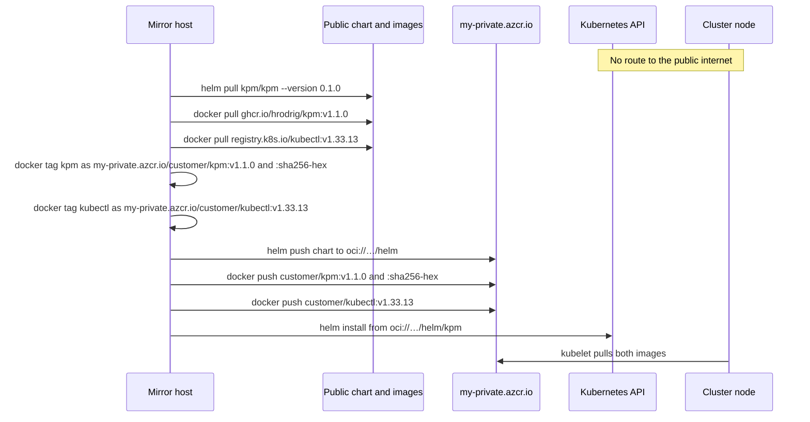

# Private registry — cluster with no egress

A private cluster often blocks outbound traffic from the nodes and from the admin bastion. AKS is one example. The same steps apply to any cluster that cannot reach the public chart site, `ghcr.io`, or `registry.k8s.io`.

Mirror the chart and the images once, from a machine that **does** have egress, into a registry the cluster can reach. After that, install and run only talk to that registry.

The names below are a stand-in for one private Azure Container Registry. A real ACR host is `<name>.azurecr.io`. Harbor, Artifactory, or any other OCI registry uses the same chart path and image path: `oci://<registry>/helm/kpm` and `<registry>/customer/kpm`.

| What | Public source | Private example |
|------|----------------|-----------------|
| Chart `kpm` `0.1.0` | `https://hrodrig.github.io/kpm-selfhosted/` | `oci://my-private.azcr.io/helm/kpm` |
| Sampler image | `ghcr.io/hrodrig/kpm:v1.1.0` | `my-private.azcr.io/customer/kpm:v1.1.0` |
| Same image, digest tag | repo digest of that pull | `my-private.azcr.io/customer/kpm:sha256-<hex>` |
| Recommend Job kubectl | `registry.k8s.io/kubectl:v1.33.13` | `my-private.azcr.io/customer/kubectl:v1.33.13` |

Prefer a normal tag (`v1.1.0`, `v1.33.13`) in Helm values. The `sha256-<hex>` tag is the alternative when policy refuses a tag that can move. The hex is the digest of the image you pulled, with `sha256:` rewritten to `sha256-` because a tag cannot contain a colon.



The mirror host is a laptop or a build agent with egress. It is not the locked bastion.

## 1. Log in

```bash
docker login my-private.azcr.io
helm registry login my-private.azcr.io
```

How the kubelet authenticates is specific to the cluster. On AKS, attaching the registry (`az aks update --attach-acr`) is one way to pull without a pull secret. The chart accepts `imagePullSecrets` when the cluster has no built-in registry integration.

## 2. Chart

On the mirror host:

```bash
helm repo add kpm https://hrodrig.github.io/kpm-selfhosted/
helm repo update
helm pull kpm/kpm --version 0.1.0
helm push kpm-0.1.0.tgz oci://my-private.azcr.io/helm
```

`helm pull` writes `kpm-0.1.0.tgz` in the current directory. Push that file. Do not point the cluster at `hrodrig.github.io`.

## 3. Images

Suggested tags, one command per image. Pull the architecture the nodes run (`--platform linux/amd64` on an arm64 laptop if the pool is amd64). `docker push` of a plain pull copies that one architecture, not the whole multi-arch index.

```bash
docker pull --platform linux/amd64 ghcr.io/hrodrig/kpm:v1.1.0
docker tag ghcr.io/hrodrig/kpm:v1.1.0 my-private.azcr.io/customer/kpm:v1.1.0
docker push my-private.azcr.io/customer/kpm:v1.1.0

docker pull --platform linux/amd64 registry.k8s.io/kubectl:v1.33.13
docker tag registry.k8s.io/kubectl:v1.33.13 my-private.azcr.io/customer/kubectl:v1.33.13
docker push my-private.azcr.io/customer/kubectl:v1.33.13
```

### Digest tag for kpm

[mirror-kpm-image.sh](mirror-kpm-image.sh) pulls one `name:tag`, keeps that tag on the destination, and also pushes `sha256-<hex>` from `RepoDigests`.

```bash
chmod +x mirror-kpm-image.sh
./mirror-kpm-image.sh \
  ghcr.io/hrodrig/kpm:v1.1.0 \
  my-private.azcr.io/customer/kpm
```

The script prints both refs. Use the `v1.1.0` line in values unless policy requires the digest tag. Re-run after every upstream image change. The hex changes when the bytes change.

## 4. Install from the private registry

The Helm client must reach the private registry and the API server. It does not need GHCR.

```bash
helm install kpm oci://my-private.azcr.io/helm/kpm --version 0.1.0 \
  --namespace kpm --create-namespace \
  --set secrets.existingSecret=kpm-secrets \
  --set image.repository=my-private.azcr.io/customer/kpm \
  --set image.tag=v1.1.0 \
  --set recommend.kubectlImage=my-private.azcr.io/customer/kubectl:v1.33.13
```

Digest tag instead of `v1.1.0`:

```bash
--set image.tag=sha256-<hex>
```

Leave `image.tag` empty only when `image.repository` is still `ghcr.io/hrodrig/kpm`. Empty means `Chart.appVersion` (`v1.1.0`) on that public repository.

Flat manifests: set `image:` on the sampler and on the recommend CronJob to the same private refs. Do not apply the sample CronJob and the Deployment against one PVC.

Create `kpm-secrets` before install, the same as the public chart. The chart still does not create that Secret.
